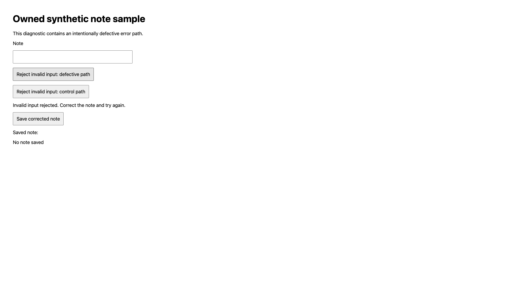
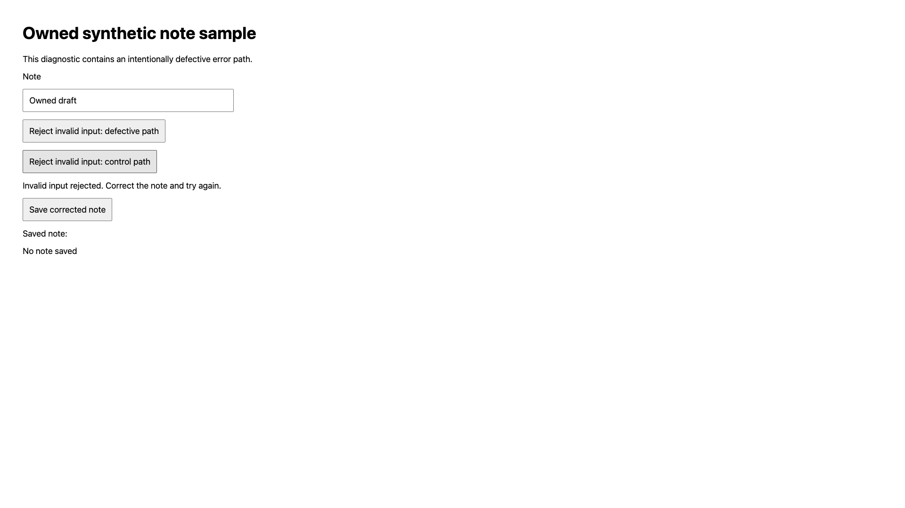

# 저장 페르소나 → 소유 정적 브라우저 여정 검증

기준일: 2026-11-12. 기준 커밋: dec4dd3829485d9e7febe935d4adee6d90134434.
작업 브랜치: rem/browser-journey-20261112.
기계 판독 기록: [browser-journey-results-20261112.json](browser-journey-results-20261112.json).
사전 기준: [browser-journey-protocol-20261112.md](browser-journey-protocol-20261112.md).

## 선택한 미완성 핵심

기존 경로는 검토된 연구/PRD 페르소나를 재사용해 Python 코어 과제를 실행하고
receipt·감사까지 연결하지만 실제 페이지의 입력·전이·결과를 관측하지 못했다.
새 브라우저 계획은 기존 WebSession 측정 드라이버와 PNG·checkpoint·swarm
검증을 재사용해 이 연결 한 개를 완성한다. 사용자는 목표와 대상만 전달하고
호스트가 실제 검토 소스에서 여정·기준·의무를 구성한다.

지원 범위는 소유한 검토 정적 파일과 합성 입력이다. 새 headless Chromium이
실제로 행동하지만 작성된 진단 페이지와 가설을 실행하는 것이다. 임의 서비스,
backend, 로그인, 기존 사용자 브라우저, 실제 Peekly UI, 실제 참여자나 효과
비교를 실행·검증한 것으로 표현하지 않는다.

## 보존과 실행 환경

- 승인된 origin, 기준 SHA와 조상 관계, AGENTS·PRD·기존 분석을 먼저 확인했다.
- 기존 root와 기준 작업트리는 clean 상태에서 새 worktree/브랜치를 만들었다.
- 원래 Peekly dirty checkout은 50개 상태 항목을 유지한 읽기 전용 대상이다.
- 최초 Peekly status SHA256: 1ae40c4182e84107555366303f747941b1fd8a2081edb8ff197800d08e5e3589.
- 최초 Peekly diff HEAD --binary SHA256: dfb732f1672427ff23cb524de77437a08fe2b0d869fe9beb35a8c0b9932afe48.
- 소유한 .ux-loop 안에 Node 22.16.0·Playwright 1.56.1·Chromium build 1194를 한 번 준비했다.
- 공식 Node tar의 SHA256은 1d7f34ec4c03e12d8b33481e5c4560432d7dc31a0ef3ff5a4d9a8ada7cf6ecc9.
- 런타임 약 753 MiB, 준비 후 가용 디스크 약 24 GiB. 전역 설치·사용자 설정은 바꾸지 않았다.
- 실행 중 설치·모델 호출·계정 로그인·실제 개인자료 전송·차단 출처 우회는 없다.

## 재현과 수정

| 단계 | 실제 결과 | 수정 또는 해석 |
| --- | --- | --- |
| 최초 browser plan admission | 기존 Python-only 경로가 execution_plan 오류로 거부, 1 error | 별도 계획·상태 버전과 브라우저 dispatch 추가 |
| 최초 실제 Chromium 진단 | 과업 실패 1·통과 1 관측, 보고서 UI 감사 실패 | row.result 밖의 outcome/reason을 audit에 바인딩 |
| 같은 실행 저장본 재검증 | 실행·런타임 재검사를 금지한 readback에서 감사 일치 | 과업을 다시 실행하지 않고 원래 증거 보존 |
| 연구 재사용 실제 Chromium 진단 | 두 과업 관측과 감사는 일치, 반복 보고서 순서 assertion 실패 | 첫 메모리 순서와 저장 후 순서가 같도록 persona 정렬 |
| 독립 parser 반례 | 다른 snapshot URL과 외부 before anchor가 수용됨 | 검토된 URL과 실제 capture chain 검증 |
| 브라우저 회귀 13개 | 13/13 통과, 1.873초 | generated 2×2 PNG parser 검증이며 실캡처가 아님 |
| 최종 독립 검토 | 기존 native auto-scroll/target-appeared pre-action capture를 새 chain 검사가 거부, 정상 4 subcase red | 실제 WebSession의 순서·현재 step·notes로 수용, foreign/unmarked capture는 계속 거부 |
| 최종 브라우저 회귀 | 15/15 통과, 2.495초 | 위 정상 pre-action/부정 capture 회귀를 포함 |

연구 진단의 중간 실행은 wall 27.93초, user 25.23초, sys 1.67초,
최대 RSS 235372544 bytes를 기록했다. 이 실행은 readback 검사가 실패했으므로
최종 통과 증거로 사용하지 않는다. 원래 출력은 덮어쓰지 않는다.

## 독립 검토에서 반영한 사항

읽기 전용 별도 검토자가 소스와 테스트를 확인했다. 입력 손실 후 timeout의
앞선 실패 보존, 종료 확인 전 추가 실행 차단, 실제 package/core/Chromium pin,
완료 readback의 런타임 독립성, 화면 밖·가림·빈 visible geometry의 not_run,
native redaction 순서, 기본 typing delay와 finish 중 취소를 수정했다.
HTTP interception을 우회하는 RTC/WebTransport에 대해서는 검토한 소유 페이지
실행 전 변경 불가 constructor guard와 검증을 추가했다. 이 소스 검토와 VM
검사는 OS 수준 네트워크 sandbox나 실제 유출 공격 시험을 뜻하지 않는다.

마지막 pre-action capture 회귀 수정 후 최종 소스 SHA256을 고정한 읽기 전용
독립 검토에서 남은 구체적인 blocker는 없었다. 같은 검토자가 첫 추출 진단의
PNG 네 장을 직접 보고 PNG 6개·native JSON 12개·두 observation·보고서 해시를
대조했다. 실제 행동/판정/화면의 일관성에 추가 모순은 없었다. 리뷰는 테스트나
브라우저를 다시 실행하지 않았고 실제 사용자 연구도 아니다.

원본 보존·readback 전후 비교는 실행된 진단의 메모리상 assertion을 통과했다.
저장된 시도 1회·recorded 상태·명령 기록도 일치하지만, 별도의 과거 전후 manifest가
없으므로 검토자가 그 과거 비교 자체를 독립 재실행했다고 표현하지 않는다.

## 최종 검증

전체 게이트는 **21/21 통과, ready=true**이다. Python 3.14.7, Node 22.16.0,
Playwright 1.56.1과 Chromium 141.0.7390.37(build 1194)로 실행했다.

| 검사 | 결과 | 경계 |
| --- | --- | --- |
| 전체 Python | 1,417 실행, 1,416 통과, 실패 0, 조건부 skip 1; 184.756초 | ERGO_PAINT_CAPTURES가 필요한 기존 ActualPaintCaptures 1개는 미실행 |
| 기존 Chromium driver | 559 통과, 실패 0; 264.51초 | shared-browser/version handshake와 ERGOQA_PYTHON captured-font 분석은 선택 skip |
| 새 bridge 계약 | 7 통과, 실패/skip 0 | pure Node 계약·VM 검사 |
| 추출 연구 브라우저 여정 | 통과, 34.10초 | 아래 합성 과제 실패 1·통과 1을 정확히 보고 |
| 패키징·무결성·재배치·기존 진단 | 통과 | 실행 뒤 무결성과 현재 소스 일치 포함 |
| 검증 중 입력 안정성 | 통과 | 실행 중 production·tests·문서를 바꾸지 않음 |

최종 실행:

```sh
python3 scripts/check_release.py --output .ux-loop/validation/browser-journey-20261112/release-confirmed
```

위 명령은 준비된 Node 22.16.0을 PATH/REMORSEARCH_JOURNEY_NODE로 선택하고,
소유 NODE_PATH·PLAYWRIGHT_BROWSERS_PATH를 지정한 환경에서 실행했다.
wall 492.40초, user 255.49초, sys 51.16초, time -l의 최대 RSS 245235712 bytes였다.
validation.json SHA256은 e95b9f999392311f92ae67eb8ccd779eb82f02e5cad97cb0b0b92ab0625cde6c이다.
개별 로그·진단·보고서·소스 해시는 연결된 검증 JSON에 보존한다.

첫 전체 게이트 release-final은 1,417개 중 문서 예산 실패 5개 때문에 ready=false였다.
SKILL 안내문의 새 링크를 간결하게 줄여 reading-budget 13개를 green으로 만든 뒤
새 release-confirmed에서 전체 게이트를 통과했다. 예산은 늘리지 않았고 첫 실패
로그·보고서를 수정하거나 덮어쓰지 않았다. 런타임 다운로드는 한 번만 수행했다.

최종 게이트 뒤에는 결과 MD/JSON과 아래 PNG 사본 세 개를 추가·갱신했다.
커밋 형식검사에서 진단 Python 두 파일과 브라우저 안내 문서의 끝 빈 줄을 하나씩
정리했다. 검증 추출본과 정확히 마지막 newline 1 byte만 다르고 Python AST는 같다.
독립 검토자가 이 차이와 새 SHA256을 다시 확인했으며 추가 blocker는 없다.

실행 엔진과 테스트 코드는 바뀌지 않았다. 작은 delivery-bundle을 다시 만들고
무결성·현재 소스 일치를 확인했다. 앞선 묶음과의 차이는 위 세 파일과 manifest뿐이다.
최종 ZIP은 4338875 bytes이며 SHA256은 e91385d6f7117088dbb3a2e0e7b1cae6b8c3f688f7c3da077aa08e28c37dc1b1이다.
release-files 12개와 README parity 10개도 통과했다. 이전 전체 게이트가 이 후속
기록과 EOF 정리의 최종 바이트까지 검사했다고 주장하지 않고 별도 해시·확인 로그를 남긴다.

## 실제 브라우저로 관측한 합성 과제

| 저장 페르소나/과제 | 행동 2: 오류 뒤 입력 | 행동 4: 수정 후 저장 | 과제 판정 |
| --- | --- | --- | --- |
| PER-RETURN / T-RETURN | 초안 손실, 실패 | 수정된 초안 저장, 통과 | 실패 유지 |
| PER-EXPLORE / T-EXPLORE | 초안 보존, 통과 | 수정된 초안 저장, 통과 | 통과 |

각 과제는 4개 행동과 5개 실제 capture를 남겼다. receipt 2건의 감사는 consistent다.
같은 PRD 의무에 연결한 두 경로의 중복 관측 1건과 상충 관측 1건도 보존한다.
따라서 task_scope_passed=false, product_ready=false, real_user_evidence=false다.
run의 예상 종료 코드는 1이며 진단 프로그램은 그 판정과 동일한 readback을 확인해
0으로 종료한다. 소프트웨어 검사의 성공과 대상 과제의 실패를 구분한다.

아래는 독립 검토자가 확인한 첫 추출 실행 release-final의 원본 PNG 사본이다.
해당 실행의 엔진 해시는 최종 소스와 같으며 진단 파일 차이는 위 EOF 정리뿐이다.
세 사본은 합계 139233 bytes,
각 1920×1080이며 재생성·편집하지 않았다. 실제 사용자나 Peekly 화면이 아니다.

**결함 경로 — 오류 직후 입력이 사라짐:**



**정상 대조 경로 — 오류 뒤에도 초안을 보존함:**



[이후 수정 내용을 저장한 복구 캡처](browser-journey-20261112/recovered.png)도 보존했다.
그 성공은 앞서 잃어버린 초안의 실패를 지우지 않는다.

## 증거의 의미와 남은 범위

- 실제 headless 브라우저에서 합성 페이지의 입력 손실과 복구·대조 완료를 관측한다.
- parser가 생성한 PNG, 가상 연구 출처와 source grade는 실제 캡처·공개 조사와 다르다.
- 실제 UI 캡처와 checkpoint는 과제별 성공/실패 근거이며 일반인의 이해·편의·수요를 측정하지 않는다.
- 교차 페르소나 감사는 결정적 일관성 검사다. 독립 사람·모델 평가나 스웜 효과 비교가 아니다.
- 각 과업은 직렬 1회, 1–30초, 최대 16개, 총 설정 시간 240초이다. 자율 다중 실행 완성을 주장하지 않는다.
- 일반 앱/backend 실행, 무준비 제품 실행, 의미 기반 행동 탐색과 실제 Peekly 여정은 남아 있다.
- 공개 커뮤니티 연구의 현재성·대표성, 실제 참여자 및 수정 전후 UX 효과 검증도 남아 있다.
- 디시 접근 제한과 유튜브 API 키 부재를 우회하지 않았다.
- 실제 브라우저 강제 timeout·유출 공격 실험은 하지 않았다. 해당 분기와 guard의 검증은 parser/VM 회귀·독립 소스 검토 범위이다.

검증 산출물은 이 worktree의 .ux-loop/validation/browser-journey-20261112 아래
새 디렉터리에 보존한다. 설치용 스킬에는 런타임·개인 자료·원시 실행 폴더를 넣지
않는다. 저장소의 검증 문서에는 위 합성 PNG 사본 세 개를 포함한다.
